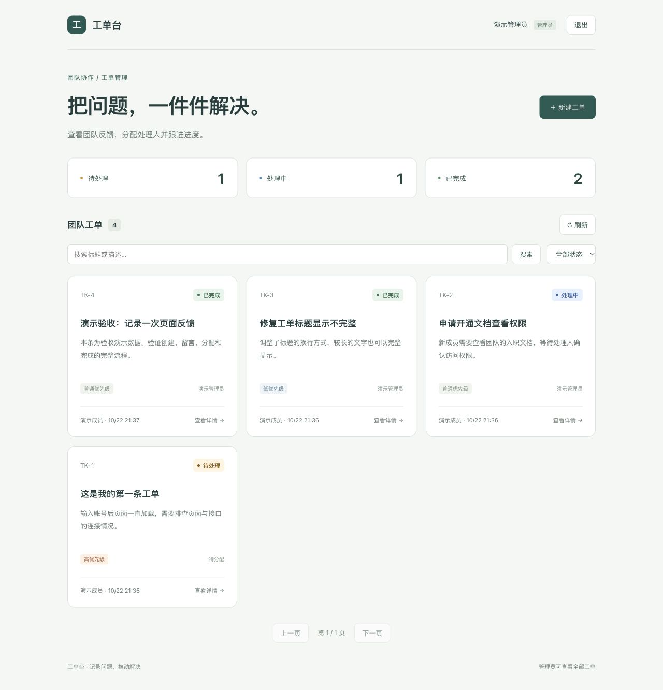

# 工单台 · 团队工单管理系统

[](https://github.com/beix945-star/ticket-system/actions/workflows/ci.yml)

一个可在本机演示的全栈工单系统：成员提交问题，管理员分配处理人，按「待处理 → 处理中 → 已完成」跟进，并保留留言与操作记录。

**状态：核心功能已实现，持续完善中。** 项目用于学习和面试展示，尚未部署为公网服务，也不宣称已经达到企业生产系统的完整性。

## 界面预览



[查看工单详情与操作记录](docs/images/ticket-detail.jpg)

截图来自本地演示数据库，包含验收用的测试工单。

## 快速了解

| 方面 | 实现 |
| --- | --- |
| 前端 | React、TypeScript、Vite，表单、筛选、分页和详情对话框 |
| 后端 | Node.js、Express，统一错误响应、登录与权限校验 |
| 数据 | SQLite（Node 内置驱动），外键、索引、参数化查询、事务 |
| 认证 | scrypt 加盐密码哈希，随机会话令牌，HttpOnly / SameSite Cookie |
| 流程 | 后端状态机、工单归属隔离、管理员分配、版本号防止旧页面覆盖 |
| 验证 | Vitest + Supertest 接口测试，TypeScript 检查，Oxlint，GitHub Actions |

## 已实现

- 注册、登录、退出，8 小时会话过期；普通成员无法注册为管理员。
- 创建、查看与编辑工单；标题、描述、优先级等参数在后端验证。
- 搜索标题与描述，按状态筛选、分页、统计数量。
- 普通成员只读写自己创建的工单；处理中只能由管理员编辑；已完成内容不可修改。
- 管理员查看全部工单，分配给管理员处理，依次开始处理和完成，不能跳过状态。
- 成员与管理员在可访问工单下留言，查看操作记录。
- 提交期间禁用按钮；失败保留表单；加载、空列表和错误提示。
- `version` 乐观并发检查，事务保证更新与审计记录同时提交。

## 运行：约 3 分钟

使用 **Node.js 24 LTS** 和 **pnpm 11.25.0**。本项目使用内置 `node:sqlite`，旧版 Node 无法运行。

```bash
git clone https://github.com/beix945-star/ticket-system.git
cd ticket-system
pnpm install --frozen-lockfile
pnpm --dir frontend install --frozen-lockfile
pnpm seed
pnpm dev
```

打开 <http://127.0.0.1:5174/>。前端代理 `/api` 到本地 3001 端口，前后端无需配置跨域。`pnpm seed` 只对空数据库执行一次，不会覆盖已有数据。

在本项目现有 Mac 环境，也可以用 `./project.sh install`、`./project.sh seed`、`./project.sh dev`，或双击 `启动项目.command` 启动。不要同时启动两个工单开发进程。

### 本地演示账号

以下是**公开的测试夹具**，仅用于空的本地演示数据库，不是真实用户凭据：

| 角色 | 用户名 | 演示密码 |
| --- | --- | --- |
| 普通成员 | demo | Demo12345! |
| 管理员 | admin | Admin12345! |
| 另一位成员（验证归属隔离） | other | Other12345! |

不运行 seed 也可以自行注册普通成员。请勿在真实服务中使用这些演示账号。生成脚本在 `NODE_ENV=production` 时拒绝运行。

## 推荐演示顺序

1. 使用 `demo` 登录，创建一条工单，添加留言，搜索并打开详情。
2. 退出后使用 `other` 登录，确认看不到该工单。
3. 使用 `admin` 登录，分配处理人，开始处理，再标记完成。
4. 打开操作记录，说明后端如何验证角色、归属和状态。
5. 展示测试文件，说明越权、非法状态和并发覆盖的断言。

详细设计见 [架构与接口](docs/架构与接口.md)。历史入门练习保留在 `docs/第1课-从数据到页面.md`，内容对应初始静态版本，不代表当前架构。

## 验证

```bash
pnpm test                 # 22 项后端接口与持久化测试
pnpm build                # 前端严格类型检查 + 生产构建
pnpm lint                 # 前端静态检查
```

测试包括未登录、错误密码、注销、会话过期、登录限流、注册角色注入、错误 JSON、过大请求、非法参数、归属隔离、状态机、版本冲突、处理人校验、评论、搜索、分页与 SQLite 重启恢复。每个测试使用独立数据库；持久化测试使用临时目录，不触碰个人演示数据。

GitHub Actions 在推送与 PR 时运行以上检查；以页面顶部的实际 CI 结果为准。

## 项目结构

```text
backend/
  app.js           API、权限、校验与事务
  db.js            数据库结构、密码哈希与演示夹具
  server.js        服务入口及静态文件服务
  seed.js          显式初始化本地演示数据
  app.test.js      接口与持久化测试
frontend/src/
  App.tsx          登录、工作台、表单与详情
  api.ts           请求、类型与错误处理
  App.css          响应式页面样式
scripts/dev.mjs    同时启动前后端
```

## 数据与部署边界

默认 SQLite 文件为 `data/tickets.sqlite`，已加入忽略规则；数据库、会话、依赖及环境变量不会提交到仓库。服务默认仅监听 `127.0.0.1:3001`。

`pnpm build && pnpm start` 可通过 <http://127.0.0.1:3001/> 演示生产构建。部署环境可设置 `DATABASE_PATH`、`PORT`、`HOST`；生产环境启用 `NODE_ENV=production` 后 Cookie 要求 HTTPS。Vite 开发代理默认仍使用 3001。

当前不包含邮件找回密码、附件、通知、组织/租户、后台账号管理或云端备份。同步 SQLite 与同步 scrypt 适合本地小规模演示；登录限流为单进程内存实现，不用于宣称高并发能力。生产上线仍需 HTTPS、独立账号、数据库备份、限流与监控策略。没有经过大规模性能或独立安全审计。

另一个作品：[纸间 Markdown 编辑器](https://github.com/beix945-star/markdown-editor)。
