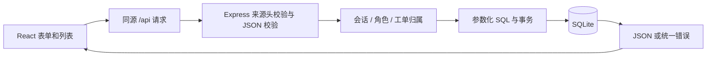
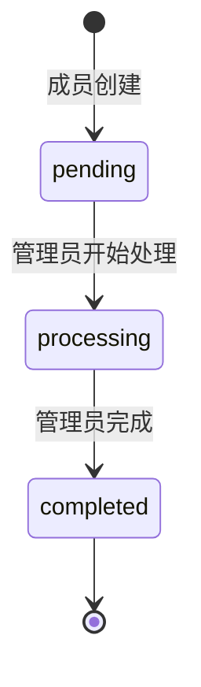

# 架构与接口

## 数据流



开发时 Vite 代理 API；构建后 Express 提供前端静态文件。前端用 TypeScript，后端用 ESM JavaScript。界面隐藏操作不是授权保障，所有写操作仍在后端验证。

## 数据模型

- `users`：唯一用户名、姓名、加盐密码哈希、user/admin 角色。
- `sessions`：随机令牌的 SHA-256 摘要、用户外键、过期时间；Cookie 仅保留原令牌。
- `tickets`：标题、描述、优先级、状态、提交人、处理人、时间、版本号。
- `comments`：工单、作者、正文、创建时间。
- `events`：工单、操作者、动作描述与时间。

外键保护关联；工单归属和记录列表有索引。新建工单与创建记录、编辑工单与审计记录分别位于同一事务中。旧版本更新返回 409，避免两个人同时打开详情后静默覆盖。

## 会话和权限

密码使用 Node scrypt 与随机盐；使用 timingSafeEqual 比较。错误账号也执行一次哈希计算。登录发放 32 字节随机令牌，存储其摘要；会话 8 小时有效，注销删除会话。

Cookie 使用 HttpOnly、SameSite=Strict；生产模式额外使用 Secure。写请求要求 `X-Requested-With: TicketApp`，服务不开放 CORS，第三方跨站自定义请求头会被浏览器预检拦截。限流按请求 IP，每分钟最多 20 次登录/注册尝试，单进程保存。

普通成员只能访问自己的工单。不存在和不可访问统一返回 404，避免泄露其他人的工单信息。管理员可以查看全部，分配处理人并更改状态。新注册账号固定为普通成员，拒绝传入额外 role 字段。

## 状态机



待处理可由提交人或管理员编辑；处理中只允许管理员编辑；已完成工单不可修改正文和状态，但可继续补充留言。当前不支持回退、重开或删除工单，保留审计链。

## 接口

| 方法与路径 | 用途 | 权限 |
| --- | --- | --- |
| GET /api/health | 健康检查 | 公开 |
| POST /api/auth/register | 注册普通成员并建立会话 | 公开、限流 |
| POST /api/auth/login | 登录 | 公开、限流 |
| GET /api/auth/me | 获取当前用户 | 登录 |
| POST /api/auth/logout | 注销当前会话 | 登录 |
| GET /api/tickets | 搜索、筛选、分页 | 本人 / 管理员全部 |
| POST /api/tickets | 创建工单 | 登录 |
| GET /api/tickets/:id | 详情、评论、操作记录 | 归属校验 |
| PATCH /api/tickets/:id | 编辑、分配、流转 | 归属 + 角色 + 状态 |
| POST /api/tickets/:id/comments | 留言 | 归属校验 |
| GET /api/stats | 状态数量 | 本人 / 管理员全部 |
| GET /api/users/assignees | 可分配管理员 | 管理员 |

列表参数：`q` 搜索（最多 100 字符）、`status`、`page`（默认 1）、`pageSize`（默认 9，最大 50）。标题 1–100 字符，描述 1–5000 字符，评论 1–2000 字符。

PATCH 必须携带读取详情时的 `version`。成功返回新版本工单；发生冲突时先重新加载再决定修改，不做盲目重试。页面提交失败保留用户输入。

错误响应统一为：

```json
{"error":{"code":"VERSION_CONFLICT","message":"工单已更新，请重新打开后再操作"}}
```

- 400：输入或 JSON 不正确。
- 401：未登录、会话失效、凭据错误。
- 403：角色不足或请求来源验证失败。
- 404：不存在或不可见。
- 409：用户名冲突、版本冲突、非法状态转换。
- 413：请求体超过 64 KB。
- 429：认证请求过于频繁。

## 面试时可以解释的取舍

- 用 Cookie 会话便于注销与过期处理，代价是服务器需要维护会话表。
- SQLite 让面试官无需搭建额外数据库即可运行，但同步调用和单机写入不是高并发架构。
- 更新时使用版本号和事务，而不是依赖前端按钮禁用解决多客户端竞争。
- 当前保留工单与操作记录，不增加难以追溯的删除入口。
- 测试验证具体返回码和数据库变化，不把功能清单当成验证结果。
